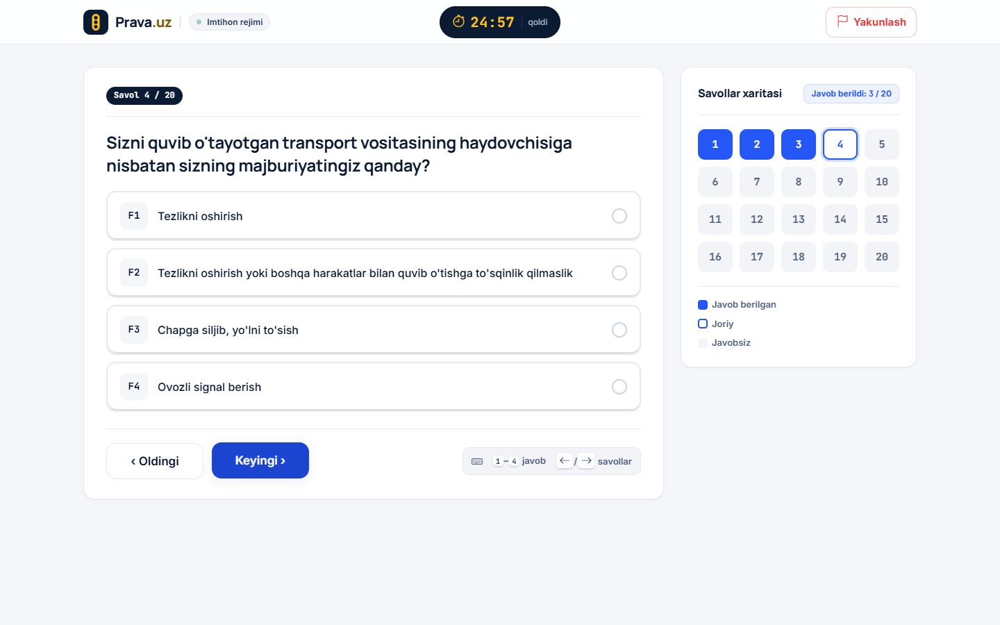
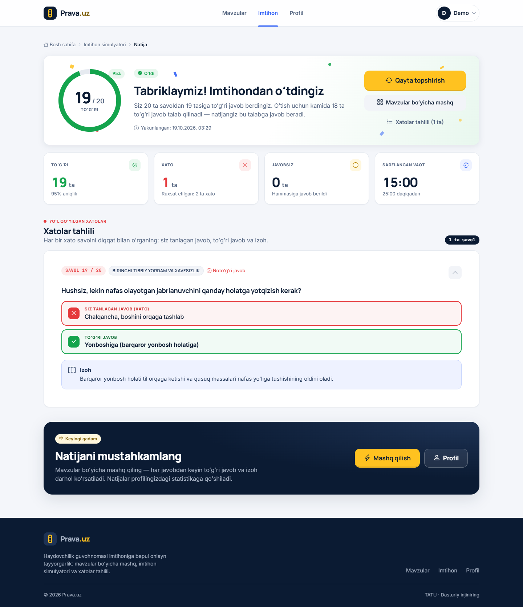
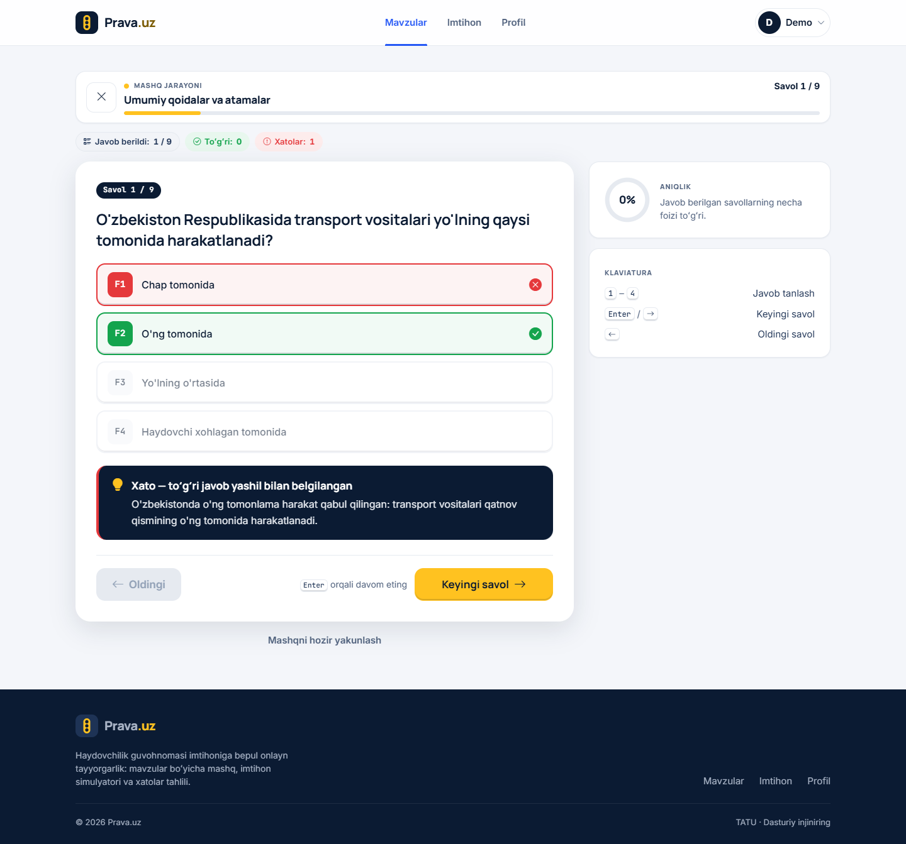
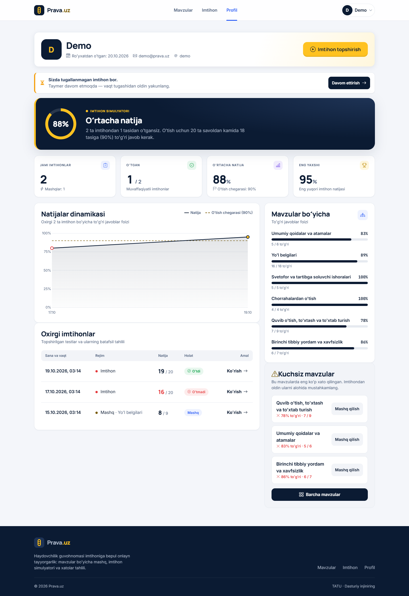
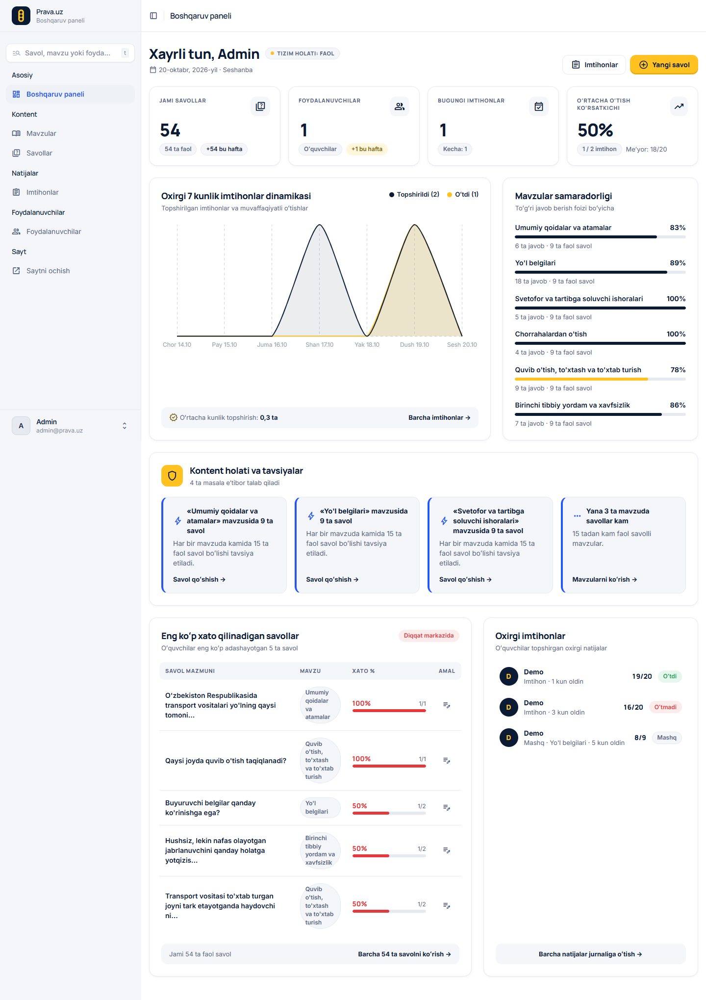
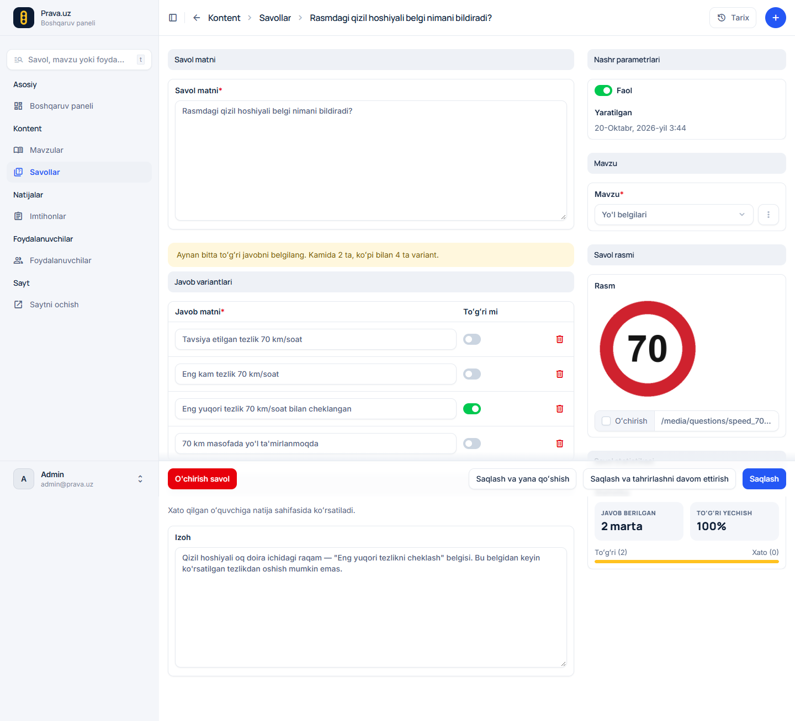

# Prava.uz — haydovchilik imtihoniga tayyorgarlik

Haydovchilik guvohnomasi nazariy imtihoniga tayyorlanuvchilar uchun bepul onlayn test sayti: mavzular boʻyicha mashq, 25 daqiqalik imtihon simulyatori va xatolar tahlili.

Universitet loyihasi — TATU, Dasturiy injiniring.

| | |
|---|---|
| Muallif | _____________________ |
| Guruh | _____________________ |
| Ilmiy rahbar | _____________________ |

## Skrinshotlar

| Imtihon ekrani (taymer, savollar xaritasi) | Natija va xatolar tahlili |
|---|---|
|  |  |
| **Mashq: javobdan keyin izoh** | **Profil va statistika** |
|  |  |
| **Admin: boshqaruv paneli** | **Admin: savolni tahrirlash** |
|  |  |

Barcha sahifalar 1440px va 375px kenglikda: [`screenshots/`](screenshots/). Himoya uchun demo ssenariysi: [`docs/demo.md`](docs/demo.md).

## Imkoniyatlar (MVP)

- Roʻyxatdan oʻtish, kirish (**username yoki email** bilan), chiqish
- 6 ta mavzu, har biri boʻyicha progress (oʻzlashtirilgan savollar %)
- **Mashq rejimi** — mavzu tanlanadi, har javobdan keyin darhol toʻgʻri/xato va izoh koʻrsatiladi
- **Imtihon rejimi** — 20 ta tasodifiy savol, 25 daqiqa, 2 tagacha xato ruxsat (18/20 — oʻtdi)
  - taymer brauzerda, vaqt nazorati serverda; sahifa yangilansa ham imtihon va taymer davom etadi
  - vaqt tugasa imtihon avtomatik yakunlanadi, muddatdan keyingi javob qabul qilinmaydi
  - savollar xaritasi, klaviatura (`1`–`4`, `←`/`→`), yakunlash modali
- **Natija sahifasi** va **xatolar tahlili** (siz tanlagan javob, toʻgʻri javob, izoh, rasm)
- **Profil va statistika** — jami/oʻtgan imtihonlar, oʻrtacha va eng yaxshi natija, natijalar dinamikasi grafigi, mavzular boʻyicha foizlar, kuchsiz mavzular
- **Yagona kirish** — `/accounts/login/` hammaga: admin → boshqaruv paneli, oʻquvchi → profil (Django admin'ning oʻz login sahifasi yoʻq)
- **Admin panel** (django-unfold) — dashboard (KPI, 7 kunlik grafik, mavzular samaradorligi, eng koʻp xato qilinadigan savollar, kontent holati), savol + 4 ta javob + rasm, aynan bitta toʻgʻri javob tekshiriladi, bulk faollashtirish/oʻchirib qoʻyish
- Telefon ekranida (360px) toʻliq ishlaydi

## Texnologiyalar

| Qism | Tanlov |
|---|---|
| Backend | Python 3.11+, Django 5.2 |
| Baza | **PostgreSQL** 14+ (asosiy; psycopg 3). Tez ishga tushirish va testlar uchun — SQLite |
| Admin | django-unfold (dizayn: `design/admin/`, stillar `static/css/admin.css`) |
| Frontend | Django shablonlari, oʻz CSS dizayn tizimi (`static/css/main.css`), Bootstrap 5.3 faqat grid va modal JS uchun, Bootstrap Icons, vanilla JS |
| Grafik | Chart.js 4 (faqat profil sahifasida, CDN) |
| Server (deploy) | Ubuntu VPS, Nginx + Gunicorn, Let's Encrypt |

> Universitet hujjatida baza sifatida MySQL koʻrsatilgan. Loyihada PostgreSQL ishlatiladi — sabablari `NOTES.md` da.

## Tez ishga tushirish (SQLite)

```bash
python -m venv .venv && source .venv/bin/activate   # Windows: .venv\Scripts\activate
pip install -r requirements.txt
cp .env.example .env            # Windows: copy .env.example .env
# .env ichida: DB_ENGINE=sqlite
python manage.py migrate
python manage.py seed_data
python manage.py runserver
```

Sayt: <http://127.0.0.1:8000/> · Admin: <http://127.0.0.1:8000/admin/>

## PostgreSQL bilan ishga tushirish

1. Baza va foydalanuvchi (`psql -U postgres`):

   ```sql
   CREATE USER prava WITH PASSWORD 'kuchli-parol' CREATEDB;
   CREATE DATABASE prava_uz OWNER prava ENCODING 'UTF8' TEMPLATE template0;
   ```

   `CREATEDB` faqat testlarni Postgres'da ishga tushirish uchun kerak (`TEST_DB_ENGINE=postgres`).

2. `.env`:

   ```ini
   DB_ENGINE=postgres
   DB_NAME=prava_uz
   DB_USER=prava
   DB_PASSWORD=kuchli-parol
   DB_HOST=localhost
   DB_PORT=5432
   ```

3. `python manage.py migrate && python manage.py seed_data && python manage.py runserver`

Drayver `psycopg[binary]` — Windows, macOS va Linux'da kompilyatsiyasiz oʻrnatiladi.

### SQLite'dagi maʼlumotni PostgreSQL'ga koʻchirish

```bash
# SQLite'da (DB_ENGINE=sqlite)
python manage.py dumpdata --natural-foreign --natural-primary \
  --exclude contenttypes --exclude auth.permission --exclude admin.logentry --exclude sessions \
  -o backup.json
# .env da DB_ENGINE=postgres qilib
python manage.py migrate
python manage.py loaddata backup.json
python manage.py sqlsequencereset accounts quiz results auth | python manage.py dbshell
```

## Demo loginlar

`seed_data` quyidagilarni yaratadi:

| Login | Parol | Rol |
|---|---|---|
| `admin` | `admin12345` | Admin (faqat `DEBUG=True` boʻlsa yaratiladi) — kirgach `/admin/` ga oʻtadi |
| `demo` | `demo12345` | Oʻquvchi, 3 ta tugallangan imtihon bilan — kirgach profilga oʻtadi |

> ⚠️ Bu parollar faqat lokal ishlab chiqish uchun. Serverda (`DEBUG=False`) demo admin yaratilmaydi — `python manage.py createsuperuser` ishlating va `demo` parolini almashtiring.

`seed_data` qayta ishga tushirilsa dublikat yaratmaydi; `--reset` — mavzular, savollar va demo maʼlumotlarni oʻchirib qayta yaratadi. Savollar matni: `quiz/fixtures/questions_uz.json` (54 savol, 6 mavzu); yoʻl belgilari rasmlari Pillow bilan chiziladi (`quiz/signs.py`).

## Yagona login va rollar

Kirish sahifasi bitta — `/accounts/login/` (username yoki email + parol). Kirgandan keyin manzil rolga qarab tanlanadi (`accounts/views.py` → `redirect_url_for`):

| Holat | Natija |
|---|---|
| Admin (`role=admin` yoki superuser) kiradi | `/admin/` — boshqaruv paneli |
| Oʻquvchi kiradi | `/accounts/profile/` |
| `?next=` bor | Faqat shu saytga tegishli va rolga ruxsat etilgan boʻlsa: oʻquvchining `next=/admin/…` yoki tashqi havola (`https://evil.com`) eʼtiborsiz qoladi |
| Mehmon `/admin/` ni ochadi | `/accounts/login/?next=/admin/` |
| Oʻquvchi `/admin/` ni ochadi | Profilga qaytariladi: «Bu boʻlimga faqat administratorlar kira oladi» |
| Kirgan foydalanuvchi `/accounts/login/` yoki `/register/` ni ochadi | Rolga qarab yoʻnaltiriladi |
| `/admin/login/` | Yagona login'ga yoʻnaltiriladi (`next` saqlanadi); admin'dan chiqish → bosh sahifa |

- **Rol — yagona manba.** `role="admin"` → `is_staff` va `is_superuser` avtomatik (`User.save()`), `user.is_admin_role` = `role == "admin" or is_superuser`. `createsuperuser` → `role="admin"`.
- **Roʻyxatdan oʻtish har doim oʻquvchi yaratadi** — formada rol maydoni yoʻq, POST'ga `role=admin` qoʻshilsa ham eʼtiborsiz qoladi.
- Admin saytning oʻquvchi qismidan ham foydalana oladi (imtihon yechib koʻrish); avatar menyusida «Boshqaruv paneli», admin sidebar'ida «Saytni ochish».

## Admin imkoniyatlari

Admin panel — Django admin + [django-unfold](https://github.com/unfoldadmin/django-unfold), dizayn manbasi `design/admin/` (Stitch).

- **Boshqaruv paneli:** 4 KPI (jami savollar, oʻquvchilar, bugungi imtihonlar, oʻrtacha oʻtish %), oxirgi 7 kunlik imtihonlar grafigi (topshirildi / oʻtdi), mavzular boʻyicha toʻgʻri javob %, eng koʻp xato qilinadigan 5 savol (tahrirlash havolasi bilan), oxirgi imtihonlar, «Kontent holati» ogohlantirishlari (izohsiz savollar, 15 tadan kam savolli mavzular, nofaol savollar). Hammasi bazadagi real maʼlumotdan, har blok bitta soʻrov.
- **Savollar:** rasm miniatyurasi, mavzu, variantlar soni, toʻgʻri javob % (chiziq bilan), faol/nofaol; filtrlar — mavzu, faol, rasmli, izohsiz; qidiruv; bulk: faollashtirish / oʻchirib qoʻyish.
- **Savol formasi (2 ustun):** chapda matn, 4 ta javob varianti (aynan bitta toʻgʻri — tekshiriladi), izoh; oʻngda holat, mavzu, rasm (preview), statistika — necha marta javob berilgan, toʻgʻri %, eng koʻp tanlangan xato variant.
- **Imtihonlar:** faqat koʻrish (oʻzgartirish va oʻchirish yopiq); filtrlar — sana oraligʻi, rejim, natija, holat; ichida 20 ta savol: tanlangan javob, toʻgʻri javob, natija.
- **Mavzular** (savollar va faol savollar soni, tartib), **foydalanuvchilar** (rol, imtihonlar soni, unfold formalari).

Unfold'da qilib boʻlmagan joylar roʻyxati — `NOTES.md`.

## Arxitektura

### Hujjat va loyiha

| Hujjatda | Loyihada | Izoh |
|---|---|---|
| Python + Django | Python 3.11, Django 5.2 | — |
| **MySQL** | **PostgreSQL** (psycopg 3) | Muallif qarori; Windows'da drayver kompilyatsiyasiz oʻrnatiladi, `select_for_update` haqiqiy qulf beradi, DDL tranzaksiyali. Batafsil — `NOTES.md`. Testlar tezlik uchun SQLite'da ham ishlaydi |
| Bootstrap | Bootstrap 5.3 grid + modal JS, oʻz dizayn tizimi (`main.css`) | Standart Bootstrap koʻrinishi olib tashlangan |
| Admin modul | Django admin + django-unfold | — |

### 5 qatlam

| Qatlam | Loyihada |
|---|---|
| 1. Taqdimot (UI) | `templates/`, `static/css/`, `static/js/` (`practice.js`, `exam.js`, `profile.js`) |
| 2. Marshrutlash | `config/urls.py`, `*/urls.py` |
| 3. Boshqaruv (view'lar) | `accounts/views.py`, `quiz/views.py`, `results/views.py` — faqat soʻrov/javob, mantiq yoʻq |
| 4. Biznes mantiq (servislar) | `results/services.py` — `start_exam`, `start_practice`, `save_answer`, `finish_exam`, `user_stats` |
| 5. Maʼlumotlar | Django modellari (ORM) + PostgreSQL (hujjatda MySQL) |

### 4 modul

| Hujjatdagi modul | Django app | Vazifasi |
|---|---|---|
| accounts | `accounts` | Roʻyxatdan oʻtish, kirish (email yoki username), profil |
| tests | **`quiz`** | Mavzular, savollar, mashq va imtihon ekranlari |
| results | `results` | Ball hisoblash, xatolar tahlili, statistika |
| admin | Django admin + unfold (`*/admin.py`, `results/dashboard.py`) | Boshqaruv paneli, savol, javob, rasm, natijalar |

> **tests moduli = `quiz` app.** Django'da `tests` nomli app test-runner va `tests.py` fayllari bilan toʻqnashadi, shuning uchun nomi `quiz`.

### 6 jadval (hujjatdagi nomlar `db_table` orqali saqlangan)

| Jadval | Model | Asosiy maydonlar |
|---|---|---|
| `foydalanuvchilar` | `accounts.User` | username, email (unique), parol (PBKDF2 xesh), role (`student`/`admin`) |
| `mavzular` | `quiz.Topic` | name, slug, description, order |
| `savollar` | `quiz.Question` | topic → mavzular, text, image, explanation, is_active |
| `javoblar` | `quiz.Answer` | question → savollar, text, is_correct (hujjatda `togri_mi`) |
| `imtihonlar` | `results.Exam` | user, mode (`exam`/`practice`), topic, started_at, finished_at, duration_seconds, total_questions, score, is_passed, status |
| `imtihon_javoblari` | `results.ExamAnswer` | exam, question, selected_answer, is_correct, order, answered_at |

Imtihon boshlanganda 20 ta `imtihon_javoblari` qatori oldindan yaratiladi — savollar tartibi saqlanadi, sahifa yangilansa ham oʻsha savollar chiqadi. `is_correct` hech qachon klientdan olinmaydi — doim serverda hisoblanadi.

### Xavfsizlik

- Har bir imtihon/natija soʻrovi `user=request.user` bilan filtrlanadi — begona imtihon → **404**
- CSRF yoqilgan (API ham `X-CSRFToken` bilan, `csrf_exempt` yoʻq); chiqish faqat POST
- Maxfiy sozlamalar faqat `.env` da (`python-decouple`); `.env` repoga kirmaydi
- `DEBUG=False` da: HTTPS redirect, secure cookie'lar, HSTS — `python manage.py check --deploy` toza

## Tarjimalar

Unfold oʻzbekcha tarjimasiz keladi — `locale/uz/LC_MESSAGES/django.po`. Oʻzgartirgandan keyin: `python tools/compile_messages.py` (GNU gettext boʻlsa `python manage.py compilemessages` ham boʻladi).

## Testlar

```bash
python manage.py test                          # SQLite'da (tez), .env dagi DB_ENGINE dan qatʼi nazar
TEST_DB_ENGINE=postgres python manage.py test  # PostgreSQL'da
```

71 ta test: roʻyxatdan oʻtish va email bilan kirish, parol xeshlanishi, servislar (20 ta takrorlanmas savol, ochiq imtihonni davom ettirish, begona javob/foydalanuvchi/muddat rad etilishi, 18/20 → oʻtdi, 17/20 → oʻtmadi, javobsiz = xato, statistika foizlari), view'lar (login'ga yoʻnaltirish, begona natija → 404, toʻliq oqim), admin (2 ta toʻgʻri javob → xato, dashboard real maʼlumot, bulk action, imtihonlar faqat oʻqish uchun), yagona login (rolga qarab yoʻnaltirish, `next` xavfsizligi, oʻquvchi `/admin/` ga kira olmaydi, roʻyxatdan oʻtishda admin boʻlib boʻlmaydi), soʻrovlar soni maʼlumot koʻpayganda oʻsmasligi (N+1 yoʻq).

### Dizayn va oqim tekshiruvi (ixtiyoriy)

```bash
pip install -r requirements-dev.txt   # playwright; kompyuterdagi Chrome ishlatiladi
python manage.py runserver 8765       # alohida terminalda
python tools/screenshots.py           # screenshots/ ga 1440px va 375px suratlar, 360px tekshiruv, toʻliq oqim
```

Skript `sinov…` nomli test foydalanuvchilar yaratadi va demo uchun ochiq imtihon qoldiradi — keyin `python manage.py seed_data --reset`.

## Keyingi rejalar

Texnik reja (kontent admin guruhi, CSV import, admin'dagi qolgan joylar) — `NOTES.md` → «Keyingi versiya». Mahsulot boʻyicha:

- Mobil ilova
- Rus tili
- Reyting jadvali
- Toʻlov va premium imkoniyatlar
- Video darslar
